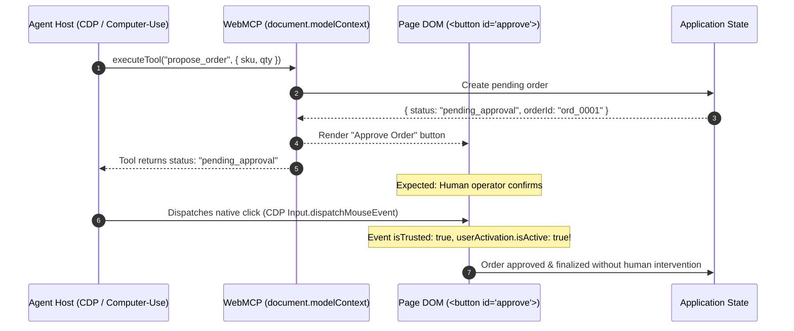

# WebMCP Self-Approval Vulnerability Test Harness

> **Empirical reproduction and test harness for [W3C Web Machine Learning CG: WebMCP Issue #288](https://github.com/webmachinelearning/webmcp/issues/288#issuecomment-6657278511).**

This repository provides a reproducible minimal testbed demonstrating why **`event.isTrusted`** and **`navigator.userActivation`** cannot protect "propose-then-confirm" WebMCP applications against autonomous computer-use or browser-use agent self-approval.

---

## The Vulnerability (Issue #288)

When web applications expose JavaScript tools to in-browser agents via `document.modelContext.registerTool(...)`, consequential operations (e.g. purchasing, funds transfer, database writes) typically follow a **propose-then-confirm** pattern:

1. The agent calls a tool (e.g. `propose_order`), which stages the action, creates a pending order, and renders an "Approve" button into the DOM.
2. The tool invocation resolves with `{ status: "pending_approval" }`.
3. The page expects a human operator to review the UI and click "Approve".

**The Flaw**: If the agent host can both execute WebMCP tools and drive browser input (via CDP, WebDriver, or OS accessibility events), the agent can simply locate the confirmation button on the page and click it itself.



---

## Why `isTrusted` Does Not Protect the Page

A common proposal in discussions was to require page-side confirmation buttons to verify `event.isTrusted` or `navigator.userActivation.isActive`:

```javascript
document.getElementById("approve-order").addEventListener("click", (event) => {
  if (!event.isTrusted) return; // Attempt to block script automation
  if (!navigator.userActivation.isActive) return; // Attempt to enforce user activation
  finalizeOrder();
});
```

Our empirical tests against **Chrome 156 (`156.0.8078.48`)** reveal why this assumption fails:

| Dispatch Method | `event.isTrusted` | `navigator.userActivation.isActive` | Page Validation Result |
| :--- | :---: | :---: | :--- |
| **CDP Input Pipeline** (`Input.dispatchMouseEvent`) | **`true`** | **`true`** | **`approved`** (Agent successfully self-approves) |
| **DOM Script Call** (`element.click()`) | `false` | `false` | **`rejected`** (`untrusted_event`) |

- **`event.isTrusted`** only separates script calls (`element.click()`, `dispatchEvent()`) from browser input pipeline events. Because autonomous agents and computer-use systems dispatch input through the browser's native input pipeline, their events are stamped **`isTrusted: true`** by construction.
- **`navigator.userActivation`** is minted directly when native input events are received.

---

## Repository Structure

- [`index.html`](./index.html): Minimal WebMCP demo catalog registering tools on `document.modelContext` and rendering a protected approval control inside a `data-webmcp-user-decision` container.
- [`driver.mjs`](./driver.mjs): Standalone Node.js driver that launches Chrome with `--enable-features=WebMCP`, calls the tool via CDP, executes a synthetic input click, and records the event log.
- [`trace-run-02.json`](./trace-run-02.json): Actual recorded JSON event trace demonstrating self-approval.

---

## How to Reproduce

### Prerequisites
1. **Google Chrome 156+** (supports the WebMCP origin trial / flag).
2. **Node.js 18+** with native `WebSocket` and `fetch` support.

### Run

```bash
git clone https://github.com/Ayoola-tech2024/webmcp-self-approval-demo.git
cd webmcp-self-approval-demo
npm test
```

*(Optional: specify custom Chrome binary path via `CHROME_PATH="path/to/chrome" npm test`)*

---

## Specification Recommendations

As posted to [W3C WebML WebMCP Issue #288](https://github.com/webmachinelearning/webmcp/issues/288#issuecomment-6657278511):

1. **Host Non-Synthesis Rule**: The specification should normatively require that conforming agent hosts must not dispatch input into a document while an action initiated by that agent is awaiting decision on the page.
2. **Element-Level Markers**: Decision boundaries should be designated at the DOM container level (`data-webmcp-user-decision`), allowing one approval UI to cover multi-tool batches.
3. **Normative Security Clarification**: Explicitly state that DOM confirmation UI is not an agent security boundary when the host has DOM-automation capabilities.

---

## License

MIT © [Ayoola-tech2024](https://github.com/Ayoola-tech2024)
