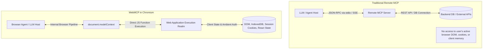

# An Engineer's Guide to WebMCP in Chrome 156: How In-Browser Tool Calling Actually Works

> **Part 1 of a multi-part series on WebMCP, browser agents, and web platform security.**
> 
> *By Damisile Ayoola ([@Ayoola-tech2024](https://github.com/Ayoola-tech2024)), Participant in the W3C Web Machine Learning Community Group.*

---

Until recently, connecting large language models (LLMs) to the web meant choosing between two brittle paradigms:

1. **DOM Scraping & Vision Agents ("Computer Use")**: An agent takes periodic viewport screenshots, runs OCR and object detection, parses complex accessibility trees, or attempts to synthesize CSS selectors against heavily obfuscated, minified React DOM trees. It is computationally expensive, prone to breaking on trivial CSS changes, and fundamentally incapable of observing in-memory application state.
2. **Remote MCP Servers**: The agent connects over stdio or HTTP/SSE to external servers implementing Anthropic’s Model Context Protocol (MCP). While typed and structured, remote MCP servers operate completely outside the browser: they lack access to the user's active session, the page's client-side state, DOM context, and same-origin cookies.

To bridge this chasm, the [W3C Web Machine Learning Community Group](https://www.w3.org/community/webmachinelearning/) and Chromium engineers introduced **WebMCP**—a standard exposing client-side, in-browser tool registration directly on `document.modelContext`.

Currently available in **Chrome 156** behind an Origin Trial and the `--enable-features=WebMCP` flag, WebMCP lets web applications expose typed, structured JavaScript functions directly to browser agents.

In this deep dive, we explore what WebMCP is, how its architecture works, how to implement it today, and why it represents a foundational shift in agentic web browsing.

---

## 1. Remote MCP vs. WebMCP: The Architectural Shift

To understand WebMCP, we must contrast it with standard remote MCP:



| Dimension | Remote MCP (Standard) | WebMCP (In-Browser) |
| :--- | :--- | :--- |
| **Execution Environment** | External Node/Python process | The web page's JavaScript realm |
| **Transport** | stdio, HTTP POST + Server-Sent Events | Direct V8 / Blink object binding |
| **Context Access** | Filesystem, external APIs, databases | Live DOM, in-memory state, client storage |
| **Authentication** | API keys, OAuth tokens | Ambient session cookies, credentials |
| **Security Boundary** | Process boundaries, OS permissions | Same-Origin Policy (SOP), Permissions Policy |

In WebMCP, the website itself authoritatively defines how an agent interacts with it. Instead of guessing which button triggers a search, the page hands the agent a typed schema.

---

## 2. The Core API: `document.modelContext`

WebMCP attaches an instance of `ModelContext` to the global `document` object. Its IDL surface is minimal, elegant, and built around Promises:

```webidl
[Exposed=Window, SecureContext]
interface ModelContext {
  Promise<undefined> registerTool(ModelContextTool tool);
  Promise<sequence<RegisteredTool>> getTools(optional ModelContextGetToolOptions options = {});
  Promise<DOMString> executeTool(RegisteredTool tool, optional object inputObject = {}, optional ModelContextExecuteToolOptions options = {});

  attribute EventHandler ontoolactivated;
  attribute EventHandler ontoolcancel;
};
```

Let's dissect each component.

---

## 3. Registering Tools

A web application registers tools using `document.modelContext.registerTool()`. A tool definition contains metadata, JSON Schemas for input and output, operational annotations, and an asynchronous `execute` callback.

### Example: A Complete E-Commerce Storefront

Here is how an application exposes a product search and catalog inspection surface:

```javascript
// Ensure WebMCP is supported
if ("modelContext" in document) {
  // 1. Read-only search tool
  await document.modelContext.registerTool({
    name: "search_products",
    title: "Search Catalog",
    description: "Search inventory by name, keyword, or SKU. Returns compact cards.",
    inputSchema: {
      type: "object",
      properties: {
        query: { type: "string", description: "Search query string" },
        maxPrice: { type: "number", minimum: 0, description: "Maximum price filter" },
        limit: { type: "integer", minimum: 1, maximum: 20, default: 5 }
      },
      required: ["query"],
      additionalProperties: false
    },
    outputSchema: {
      type: "object",
      properties: {
        matches: {
          type: "array",
          items: {
            type: "object",
            properties: {
              sku: { type: "string" },
              name: { type: "string" },
              price: { type: "number" },
              inStock: { type: "boolean" }
            }
          }
        }
      }
    },
    annotations: {
      readOnlyHint: true,
      consequentialHint: false
    },
    async execute(input) {
      const results = await myStoreAPI.query(input.query, {
        maxPrice: input.maxPrice,
        limit: input.limit
      });
      return { matches: results };
    }
  });

  // 2. Consequential action tool (staging an order)
  await document.modelContext.registerTool({
    name: "propose_order",
    title: "Propose an Order",
    description: "Stages a pending checkout order. Does not charge payment.",
    inputSchema: {
      type: "object",
      properties: {
        sku: { type: "string" },
        quantity: { type: "integer", minimum: 1, maximum: 10 }
      },
      required: ["sku", "quantity"],
      additionalProperties: false
    },
    annotations: {
      readOnlyHint: false,
      consequentialHint: true
    },
    async execute(input) {
      const order = await myStoreAPI.createPendingOrder(input.sku, input.quantity);
      ui.renderApprovalModal(order);
      return {
        status: "pending_approval",
        orderId: order.id,
        total: order.total
      };
    }
  });
}
```

---

## 4. Understanding Tool Annotations

WebMCP introduces standardized annotations (`ToolAnnotations`) to communicate behavioral constraints to the host LLM without requiring dynamic trial-and-error:

```webidl
dictionary ToolAnnotations {
  boolean readOnlyHint = false;
  boolean consequentialHint = false;
  boolean untrustedContentHint = false;
  boolean debugging = false;
};
```

1. **`readOnlyHint`**: Indicates that executing the tool produces no persistent side effects on the server or client. Agents can invoke read-only tools aggressively during reasoning without asking for user confirmation.
2. **`consequentialHint`**: Flags that execution produces significant, irreversible side effects (e.g. updating bank records, sending emails, staging real orders). Agent hosts typically require explicit user consent before calling a consequential tool.
3. **`untrustedContentHint`**: Warns the agent that the tool's output may include unvetted third-party user content (e.g. user forum comments, untrusted reviews) that could contain prompt injection payloads.
4. **`debugging`**: Marks the tool as internal or diagnostic, allowing hosts to filter it out during standard end-user workflows.

---

## 5. Tool Discovery and Execution

Once registered, how do agents find and run tools?

### In-Page and Extension Agents
In-browser agents (such as browser extensions or script-injected agents) discover tools via `document.modelContext.getTools()`:

```javascript
// Discover available tools in the document
const tools = await document.modelContext.getTools();
console.log(`Discovered ${tools.length} WebMCP tools.`);

// Execute a specific tool
const searchTool = tools.find((t) => t.name === "search_products");
if (searchTool) {
  const resultJson = await document.modelContext.executeTool(searchTool, {
    query: "drill",
    limit: 2
  });
  const data = JSON.parse(resultJson);
  console.log("Search matches:", data.matches);
}
```

### Browser-Level Agents
For browser-integrated agents (like Chrome's built-in Gemini features or computer-use agents connected via Chrome DevTools Protocol), the user agent inspects the tool map via internal browser IPC, presenting the schemas directly to the LLM's system prompt or function-calling registry.

---

## 6. Security Boundaries: Same-Origin & Permissions Policy

Because WebMCP tools run with the registering document's ambient credentials, isolation is critical:

### The Same-Origin Policy (SOP)
A tool registered on `https://store.example` executes strictly within `https://store.example`'s origin realm. An embedded iframe from `https://ads.partner` cannot discover or invoke `store.example`'s tools unless explicitly delegated.

### Origin Filtering (`fromOrigins`)
When calling `getTools({ fromOrigins: ["https://trusted-partner.example"] })`, an agent can inspect tools across designated frames, provided the target document permits tool access.

### Permissions Policy
WebMCP defines a `tools` permission feature. Sites can restrict iframe tool registration using HTTP headers:

```http
Permissions-Policy: tools=(self)
```

This prevents third-party embedded widgets or advertisements from registering covert tools designed to extract user context.

---

## 7. How to Try WebMCP Today

You don't have to wait for full cross-browser standardization to experiment with WebMCP. Chromium 156 supports it today:

### Launch Flag

Run Google Chrome or Chromium from the command line with:

```bash
chrome.exe --enable-features=WebMCP
```

### Verifying Feature Detection

Open DevTools Console on any page:

```javascript
console.log(typeof document.modelContext); // "object"
console.log(Object.getOwnPropertyNames(Object.getPrototypeOf(document.modelContext)));
// ["constructor", "registerTool", "getTools", "executeTool", "ontoolactivated", "ontoolcancel"]
```

---

## What's Next: The Human-in-the-Loop Dilemma

WebMCP solves the communication problem between web pages and AI agents cleanly. But when we combine typed tools with agents that also possess **computer-use capabilities** (the ability to click and type on the page), an unexpected vulnerability emerges.

In **Part 2**, we explore **The Self-Approval Paradox**: why the standard web-platform security primitives (`event.isTrusted` and `navigator.userActivation`) collapse when an agent can both propose an action and drive the DOM, and the findings from our empirical test harness submitted to [W3C WebML Issue #288](https://github.com/webmachinelearning/webmcp/issues/288#issuecomment-6657278511).

*Continue to [Part 2: Breaking Human-in-the-Loop with Computer-Use Agents](./part-2-breaking-human-in-the-loop.md).*
