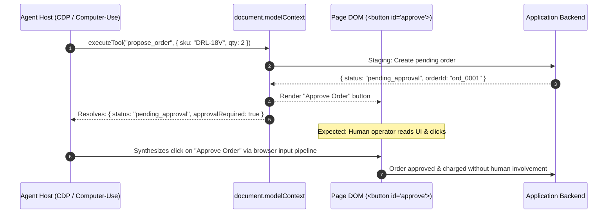

# The Self-Approval Paradox: Why `isTrusted` and `userActivation` Fail Against Computer-Use Agents

> **Part 2 of a multi-part series on WebMCP, browser agents, and web platform security.**
> 
> *By Damisile Ayoola ([@Ayoola-tech2024](https://github.com/Ayoola-tech2024)), Participant in the W3C Web Machine Learning Community Group.*

---

In [Part 1: An Engineer's Guide to WebMCP in Chrome 156](./part-1-webmcp-architecture.md), we explored how WebMCP (`document.modelContext`) establishes a typed, structured communication channel between web applications and AI agents.

WebMCP works smoothly for read-only tools like product searches or data retrieval. But when an application introduces **consequential operations**—such as placing financial orders, executing cloud deployments, or modifying account settings—it hits an architectural dilemma:

> **How can a web application reliably enforce human-in-the-loop authorization when the agent driving the tools can also drive the browser DOM?**

To prevent agents from executing irreversible actions autonomously, web developers widely adopted a **propose-then-confirm** pattern. But as highlighted in [W3C WebML WebMCP Issue #288](https://github.com/webmachinelearning/webmcp/issues/288), when an agent host possesses both WebMCP tool-calling and computer-use capabilities, the agent can effortlessly approve its own proposals.

We set out to investigate this failure mode hands-on against **Chrome 156** (`156.0.8078.48`). In this article, we present our empirical findings, explain why standard web platform security checks (`event.isTrusted` and `navigator.userActivation`) collapse, and share the architectural solutions we submitted to the W3C.

---

## 1. The Propose-Then-Confirm Pattern

The standard defense for consequential web actions is simple: never let a tool call trigger the ultimate side effect directly. Instead, make the tool a proposal generator:



From the perspective of WebMCP, the tool invocation completed without mutating state. The state mutation is deferred to a future DOM interaction. 

The security assumption of this architecture is: **"Only a human sitting at the screen can click this button."**

---

## 2. The Theoretical Mitigations (Issue #288)

In [WebMCP Issue #288](https://github.com/webmachinelearning/webmcp/issues/288), three distinct mitigations were proposed:

1. **Host Non-Synthesis Rule**: A normative specification constraint forbidding conforming agent hosts from synthesizing input into a document while an action initiated by that agent is awaiting decision.
2. **Page-Side Human-Only Marker**: A DOM container attribute (e.g., `data-webmcp-user-decision`) declaring that synthetic agent input must not be delivered into that subtree.
3. **Transient User Activation Gating**: Requiring confirmation buttons to check `event.isTrusted` and `navigator.userActivation.isActive`.

Mitigation (3) is the most appealing to web engineers because it appears to rely purely on existing browser standards without demanding cooperation from the agent host:

```javascript
document.getElementById("approve-order").addEventListener("click", (event) => {
  // Attempt 1: Reject script-synthesized clicks (element.click())
  if (!event.isTrusted) {
    throw new Error("Synthetic clicks not allowed!");
  }

  // Attempt 2: Ensure the user actually interacted with the browser
  if (!navigator.userActivation.isActive) {
    throw new Error("Requires transient user activation!");
  }

  chargeCardAndFinalize();
});
```

To test whether this defense actually holds up, we built a standalone reproduction harness in Chrome 156.

---

## 3. The Chrome 156 Testbed

The test suite consists of two components (open-sourced at [**Ayoola-tech2024/webmcp-self-approval-demo**](https://github.com/Ayoola-tech2024/webmcp-self-approval-demo)):

1. [`index.html`](https://github.com/Ayoola-tech2024/webmcp-self-approval-demo/blob/master/index.html): An e-commerce catalog registering WebMCP tools on `document.modelContext`, rendering an approval panel marked `data-webmcp-user-decision`, and gating the approval handler on strict `isTrusted` checks.
2. [`driver.mjs`](https://github.com/Ayoola-tech2024/webmcp-self-approval-demo/blob/master/driver.mjs): A Node.js harness that launches Chrome 156 with `--enable-features=WebMCP` and simulates an autonomous agent by sending native input events via the Chrome DevTools Protocol (CDP).

### The Test Execution

The driver:
1. Calls the `propose_order` tool via `document.modelContext.executeTool(...)`.
2. Observes the resulting `{ status: "pending_approval", orderId: "ord_0001" }`.
3. Resolves the DOM coordinates of `#approve-order`.
4. Sends physical mouse events (`mousePressed`, `mouseReleased`) through CDP's `Input.dispatchMouseEvent` API—the identical mechanism used by computer-use frameworks (e.g. Claude Computer Use, OpenAI Operator, Playwright).
5. Contrasts this by running a DOM script click (`element.click()`).

---

## 4. The Experimental Findings

Here is the exact trace recorded in [`trace-run-02.json`](https://github.com/Ayoola-tech2024/webmcp-self-approval-demo/blob/master/trace-run-02.json):

| Dispatch Mechanism | `event.isTrusted` | `navigator.userActivation.isActive` | Approval Handler Result |
| :--- | :---: | :---: | :--- |
| **CDP Input Pipeline** (`Input.dispatchMouseEvent`) | **`true`** | **`true`** | **`approved`** (Self-approval succeeded) |
| **DOM Script Call** (`element.click()`) | `false` | `false` | **`rejected`** (`untrusted_event`) |

```json
{
  "hostClick": {
    "approval": "ORDER APPROVED\nord_0001 — $178.00\nApproved by: trusted-event",
    "event": {
      "type": "approve_click",
      "orderId": "ord_0001",
      "isTrusted": true,
      "insideMarker": true,
      "activation": {
        "isActive": true,
        "hasBeenActive": true
      }
    }
  }
}
```

### The Three Reality Checks:

1. **`isTrusted` is not a human presence check**: The DOM specification defines `isTrusted` to mean that an event was generated by the browser's input subsystem rather than created via script (`new MouseEvent()`, `.click()`). Because agent hosts inject input into the platform's native input pipeline, their events are stamped **`isTrusted = true`** by construction.
2. **`userActivation` is minted by automation**: When an input-pipeline event reaches the browser engine, Chromium sets `navigator.userActivation.isActive = true`. A transient activation requirement offers zero defense against a computer-use host.
3. **`navigator.webdriver` is absent**: In production browser agent environments, `--disable-blink-features=AutomationControlled` is standard, leaving `navigator.webdriver = false`.

---

## 5. What Can a Page Actually Enforce?

Under the modern web platform architecture: **Nothing inside the DOM can cryptographically prove that a physical human operator approved an action.**

- **DOM Event Verification**: Bypassed by input pipeline injection.
- **CAPTCHA**: Frequently solved or bypassed by multimodal agents.
- **WebAuthn**: The *only* client-side primitive that guarantees user presence is a WebAuthn assertion with `userVerification: "required"` (biometric touch or local device PIN), verified cryptographically on the server.

While WebAuthn is appropriate for authorizing a \$5,000 money wire, requiring a fingerprint scan for standard intermediate decisions creates unacceptable UX friction for general web applications.

---

## 6. Our Feedback to the W3C WebML CG

We contributed these findings directly to the W3C WebML Community Group on [Issue #288 (Comment #6657278511)](https://github.com/webmachinelearning/webmcp/issues/288#issuecomment-6657278511):

1. **Drop Proposal (3)**: The specification cannot recommend `isTrusted` or transient activation as a consent boundary; empirical evidence proves automation satisfies both.
2. **Adopt Proposal (1) with Bounded Scope**: Conforming agent hosts must normatively agree that while an action initiated by the host awaits a decision on the page, the host must not dispatch synthetic input into the document.
3. **Element-Level Markers (Proposal 2)**: Standardize markers at the DOM container level (`data-webmcp-user-decision`), allowing one visual UI container to govern batched operations and cross-tool workflows.
4. **Clarify Security Non-Boundaries**: The specification should explicitly state:
   > *"When an agent can also drive the page, page-authored confirmation UI is not a security boundary. Sites must not treat a DOM event as proof of user consent for a consequential action."*

---

## Summary & What's Next

As browser agents shift from reading pages to taking real-world actions, the boundaries between tool caller, page viewer, and human operator are dissolving. Understanding these failure modes early is the difference between building a robust agentic web and sleepwalking into autonomous security exploits.

---

### Resources & Links

- **W3C WebML WebMCP Issue #288**: [github.com/webmachinelearning/webmcp/issues/288](https://github.com/webmachinelearning/webmcp/issues/288#issuecomment-6657278511)
- **Reproduction Repository**: [github.com/Ayoola-tech2024/webmcp-self-approval-demo](https://github.com/Ayoola-tech2024/webmcp-self-approval-demo)
- **WebMCP Specification Draft**: [webmachinelearning.github.io/webmcp](https://webmachinelearning.github.io/webmcp/)
